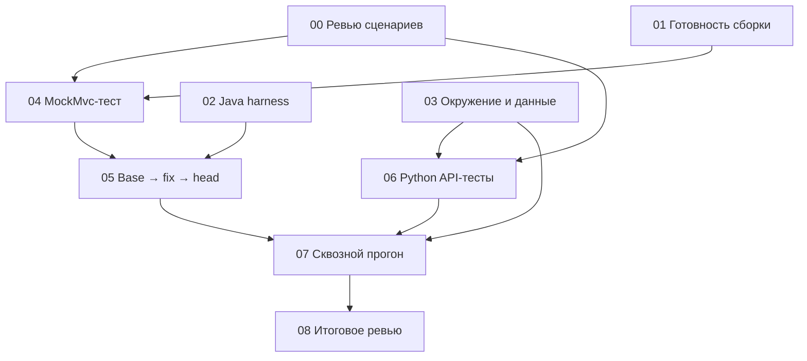

# Промпты агентов: пилот CAT-UPD-VAL

22A/B/AR/C приняты как весь offline-этап 22:
[wave 31](../handoffs/coordination-wave-31.md),
[сводный handoff](../handoffs/22-github-pr-transport.md).
Повторно исполнителей 22 и 19A2 не запускать. Следующий шаг —
отдельное разрешение локальных immutable Git heads по готовому
пакету `artifacts/git-pr/coordinator-22-final-20261116/`;
commit/push/PR пока не разрешены. Ниже история очереди.

Актуальное поручение — [22C: CLI wiring/integration](22c-cli-and-http-integration.md).
[Приёмка A/B после 22AR — wave 30](../handoffs/coordination-wave-30.md).
Можно запускать C; пользователь запускает исполнителя. A/B и 19A2
повторно не выполнять. Реальные tokens/Git/PR writes не разрешены.
Ниже история очереди.

Актуальное поручение — [22AR: GitHub snapshot corrections](22ar-github-snapshot-corrections.md).
[Проверка A/B — wave 29](../handoffs/coordination-wave-29.md): B принят,
A имеет два воспроизведённых P1; C не запускать до приёмки исправлений.
Один исполнитель, запускает пользователь. B повторно не выполнять.
Ниже история очереди.

22 разделён: [22A — GitHub HTTP transport](22a-github-http-transport.md)
и [22B — body/checkpoints](22b-pr-body-and-checkpoints.md) можно запускать
сразу параллельно. [22C — CLI/integration](22c-cli-and-http-integration.md)
запускать после приёмки A/B координатором, не одновременно с ними.
[Wave 28](../handoffs/coordination-wave-28.md),
[общий интерфейс](../design/22-pr-transport-interface.md).
Единое поручение 22 целиком не запускать. Пользователь запускает
исполнителей; общий review и окончательная приёмка — координатору.
Ниже предыдущие статусы.

Актуальное поручение — [22: GitHub PR transport и CLI wiring](22-github-pr-transport.md).
[Wave 27](../handoffs/coordination-wave-27.md): оба пакета 19A2 приняты;
перед публикацией нужен реальный программный PR boundary с offline tests.
Один исполнитель, запускает пользователь. Повторять 19A2 не требуется;
Git writes, live PR/TestOps и доступ к реальным токенам не разрешены.
Ниже история очереди.

Актуальная очередь: [19A2-QA](19a2-qa-package-refresh.md) и
[19A2-APP](19a2-app-package-refresh.md) — независимая локальная подготовка
пакетов двух репозиториев. Можно параллельно, запускает пользователь.
[Приёмка 21/21R/21R2 — wave 26](../handoffs/coordination-wave-26.md).
Старые ревью/исправления повторно не запускать. Git writes запрещены,
интеграция и следующий публикационный план — после двух handoff.
Ниже история.

Актуальное поручение: [21R2 — PR lineage deduplication](21r2-pr-lineage-deduplication.md).
[Проверка 21R, wave 25](../handoffs/coordination-wave-25.md): A/C приняты;
в B открыт P1 после parent adoption и пустого child search.
Один исполнитель, запускает пользователь. A/C повторно не запускать;
Git/PR этап ждёт общей приёмки. Далее история очереди.

Актуальная очередь после независимого ревью 21:
[21R-A — schema/envelopes](21r-a-state-and-envelopes.md),
[21R-B — orchestration/recovery](21r-b-orchestration-and-recovery.md),
[21R-C — runbook/каталог](21r-c-runbook-and-catalogue.md).
Можно выполнять параллельно в назначенных write scopes; запускает пользователь.
[Wave 24](../handoffs/coordination-wave-24.md),
[сводное решение](../handoffs/21-independent-workflow-review.md).
21A/B/C уже завершены — повторно и вместе с единым 21 не запускать.
Зависимый Git/PR этап ждёт общей приёмки исправлений. Ниже история.

21 разделён на **три независимые параллельные части**:
[21A — состояние/evidence](21a-state-and-evidence-review.md),
[21B — эффекты/recovery](21b-effects-and-recovery-review.md),
[21C — CLI/сквозной повтор](21c-cli-and-repeat-review.md).
[Организация и общая приёмка](../handoffs/coordination-wave-23.md).
Можно запускать все три сразу; отдельное полное поручение 21 не дублировать.

20/20R2 принят координатором как offline-реализация:
[wave 22](../handoffs/coordination-wave-22.md).
Следующее задание — [21: независимое ревью/повтор](21-independent-workflow-review.md)
для нового исполнителя, которого запускает пользователь. Live writes,
commit/push/PR не разрешены. Прежние поручения 20R/20R2 ниже — история.

Следующее поручение — [20R2: evidence/PR identity и checkpoints](20r2-evidence-and-pr-identity.md).
[Проверка 20R координатором](../handoffs/coordination-wave-21.md): 32 targeted
passed и старые пять проб подтверждены, но остаются четыре группы замечаний.
Независимую задачу 21 до приёмки исправлений не начинать.

Следующее поручение — [20R: исправления приёмки оркестратора](20r-orchestrator-corrections.md).
20 предоставлен ready, но координатором не принят:
[пять воспроизведённых замечаний](../handoffs/coordination-wave-20.md).
21 до приёмки исправлений не запускать. Исполнителя запускает пользователь.

19A/19B проверены координатором: [приёмка и обязательные уточнения](../handoffs/coordination-wave-19.md).
Следующее поручение — [20: реализация оркестратора и offline-проверки](20-orchestrator-implementation.md).
Исполнитель 20 работает один; 21 выдаётся после его приёмки.
Live API/TestOps, commit/push/PR в 20 не разрешены.

Следующая подготовленная волна после принятого 18:
[19A — локальный Git/PR-пакет](19a-git-pr-preparation.md) и
[19B — контракт оркестратора](19b-orchestrator-contract.md).
Можно выполнять параллельно в указанных непересекающихся областях.
Исполнителей запускает пользователь. Реализация 20 — после приёмки 19B;
commit/push/PR не разрешены. [План координатора](../handoffs/coordination-wave-18.md).

Дата: 2026-11-14. Это задания для следующей итерации, а не отчёт об их выполнении.
Каждый файл содержит самостоятельный промпт: передай агенту весь его текст.
Пути соответствуют текущей машине; при работе в другом checkout замени корни.

2026-11-15: **16 завершён и принят**, launch 57316, шесть passed,
bindings подтверждены, persisted uploaded, attempts=1:
[волна 13](../handoffs/coordination-wave-13.md).
Следующее поручение — [17: закрепление ID и финальный execution](17-bound-final-execution.md).
Новый upload/close в 17 не разрешён. Полный MVP пока не завершён.

17 завершён и принят: [wave 15](../handoffs/coordination-wave-15.md),
execution `run-ni_5bvnc`, шесть passed, готов локальный bind-пакет.
Следующее поручение — [18: финальная bind-публикация](18-bound-publication.md);
оно выполнено и принято: [wave 17](../handoffs/coordination-wave-17.md).
Launch 57317, uploaded/confirmed, attempts=1, шесть существующих кейсов.
Предыдущие остановки 18C сохранены исторически. Повторная публикация
не требуется. Дальше остаются Git/PR, оркестратор и оценка MVP;
commit/push/PR пока не разрешены.

Выполненная параллельная подготовка:
[16A — локальный пакет](16a-testops-package.md) и
[16B — read-only preflight](16b-testops-live-preflight.md).
16A единолично пишет рабочий state, 16B его не меняет и не блокирует.
После их приёмки координатором и отдельного разрешения публикации —
[16C — последовательная публикация](16c-testops-publication.md).
Общее поручение 16 остаётся контекстом; целиком вместе с 16A/16B его не запускай.

Предыдущая приёмка: 15A/15B интегрированы координатором — явный REST verify,
строгий снимок и сверка результатов/bindings. Проверки: 233 unit passed,
248 collected, API-контракт неизменён. Непустой live launch пока не проверен;
внешних публикаций/PR нет. Следующий этап — отдельно разрешённая первая
публикация пилота и live verification:
[координация девятой волны](../handoffs/coordination-wave-9.md).

Состояние после 07: API baseline — 4 ожидаемых failed, fix — 6 passed;
cleanup категорий подтверждён. 08 завершён: функциональная часть принята,
два P2 ограничивают полноту сохранённого evidence, блокирующих дефектов кода нет.
Материалы: [третья волна](../handoffs/coordination-wave-3.md).
Подготовлено последующее [поручение 09 — API evidence](09-api-evidence.md)
для устранения ограничений воспроизводимости будущих прогонов; оно выполнено
и принято, реальная проверка нового evidence остаётся задачей 10.

История второй волны: 00/01/02 интегрированы; отчёты 03 и 04 найдены и проверены.
03 принят как статический контракт fixtures; 04 дал ожидаемый baseline
MockMvc (2 passed / 4 failed). 05 и 06 выполнены параллельно и приняты:
MockMvc после fix — 6 passed, offline Python unit — 58 passed.
Очередь Gradle свободна. Следующая задача — 07. Решения и приёмка:
[координация второй волны](../handoffs/coordination-wave-2.md).

## Запуск по фазам

| Фаза | Задачи | Что выполняется параллельно | Условие перехода |
| --- | --- | --- | --- |
| 1. Подготовка | [00 — ревью сценариев](00-scenario-review.md), [01 — сборка](01-build-readiness.md), [02 — Java harness](02-java-harness.md), [03 — окружение](03-runtime-plan.md) | Все четыре независимы; при лимите 4 слота и работающем координаторе запускай по три задачи | Сценарии проверены; сборка готова; harness проверен; способ окружения описан |
| 2. Подготовка проверок | [04 — MockMvc-тест](04-gateway-regression.md), [06 — Python API-тесты](06-python-api.md) | Можно писать параллельно после стабилизации требований и контракта fixtures | MockMvc-тест готов; агент 05 получил актуальный набор тестов и команды |
| 3. Доказательство и исправление | [05 — base → fix → head](05-baseline-and-fix.md) | Его работа может идти вместе с разработкой Python-кода 06; исходный gateway никто больше не меняет | Реальный red/green либо честно зафиксированная невозможность воспроизведения |
| 4. Сквозной прогон | [07 — API-прогон и передача TestOps](07-integration.md) | Только после готовности 03, 05 и 06; работы с общей БД последовательны | Подтверждены SHA, реальные HTTP-проверки, повторный GET и cleanup |
| 5. Итоговое ревью | [08 — независимая проверка](08-final-review.md) | Статическое ревью допустимо раньше, финальное заключение — после 07 | Понятно, что доказано, что блокирует MVP и что готово для draft PR |

Текст теста 04 можно готовить до завершения 01, но завершённым воспроизведением
это не считается. Для 06 сначала достаточно согласованного контракта fixtures
из 03; реальное окружение обязательно к 07. Если 03 оставляет нерешённые вопросы,
06 может исследовать транспорт, но не закреплять предположения как готовую интеграцию.

## Правила координации

- Координатор назначает файлы и проверяет входы задачи перед запуском следующей.
  При передаче задания укажи, какие upstream-отчёты уже готовы.
- Агенты пишут в выделенные области. README, AGENTS, планы и общие каталоги
  компонентов интегрирует координатор по описанию изменений от исполнителя.
- Продуктовый контроллер изменяет только 05, после сохранения baseline.
  01 меняет только доказанно необходимые файлы сборки; 04 — тестовый файл.
- 01, 04 и 05 не запускают Gradle одновременно в одном checkout. У них общие
  build-каталоги, и это может смешать JUnit-результаты. Python-запуски и
  статическое чтение других файлов могут идти параллельно с Java-сборкой.
- Один запуск — отдельный каталог evidence. SHA плюс dirty-флаг недостаточны
  для точного описания незакоммиченного эксперимента: сохраняй patch и/или
  хеши изменённых файлов, включая новый тест. Не помещай секреты в evidence.
- Не переключай и не сбрасывай общий checkout во время работы других агентов.
  При необходимости изоляции координатор выбирает подходящий checkout/worktree
  по правилам среды. Не создавай новые пользовательские чаты без запроса.
- Статическое заключение, MockMvc с mock, реальный API-прогон и синхронизация
  TestOps имеют отдельные критерии. Не заменяй один результат другим.
- Публикация PR и запись в TestOps — отдельные внешние действия: 07 готовит
  артефакты и выполняет их только при явном поручении на соответствующее действие.

## Формат передачи результата

Каждый агент создаёт свой отчёт в `docs/qa-workflow/handoffs/`:

1. Статус: `ready`, `blocked` или `needs_decision`.
2. Изменённые файлы и версии входов.
3. Команды, exit codes, число реально выполненных тестов и путь к evidence.
4. Что подтверждено и что не проверялось.
5. Решения/блокеры и следующий исполнитель.

Названия статусов относятся к отчёту задачи, а не к API целей Codex.
Недостающие входы перечисляй точно; не объявляй всю работу выполненной.

## Первый пакет для запуска

Первоначальный пакет 00/01/02 завершён; 03/04 повторно не запускать.
Пакет 05/06 также завершён. Готовое поручение 07 содержит входы,
команды, требования к evidence и ограничения окружения; API env ещё не заданы.
