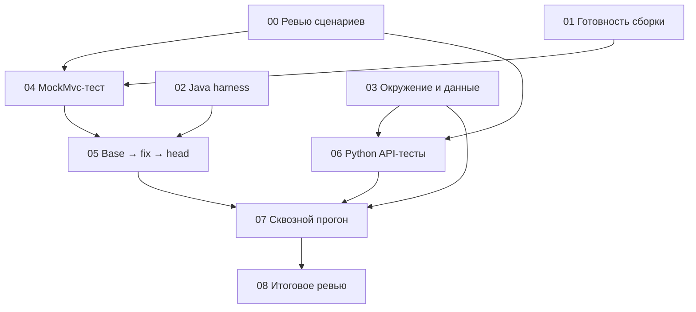

# Промпты агентов: пилот CAT-UPD-VAL

Дата: 2026-11-14. Это задания для следующей итерации, а не отчёт об их выполнении.
Каждый файл содержит самостоятельный промпт: передай агенту весь его текст.
Пути соответствуют текущей машине; при работе в другом checkout замени корни.

## Запуск по фазам

| Фаза | Задачи | Что выполняется параллельно | Условие перехода |
| --- | --- | --- | --- |
| 1. Подготовка | [00 — ревью сценариев](00-scenario-review.md), [01 — сборка](01-build-readiness.md), [02 — Java harness](02-java-harness.md), [03 — окружение](03-runtime-plan.md) | Все четыре независимы; при лимите 4 слота и работающем координаторе запускай по три задачи | Сценарии проверены; сборка готова; harness проверен; способ окружения описан |
| 2. Подготовка проверок | [04 — MockMvc-тест](04-gateway-regression.md), [06 — Python API-тесты](06-python-api.md) | Можно писать параллельно после стабилизации требований и контракта fixtures | MockMvc-тест готов; агент 05 получил актуальный набор тестов и команды |
| 3. Доказательство и исправление | [05 — base → fix → head](05-baseline-and-fix.md) | Его работа может идти вместе с разработкой Python-кода 06; исходный gateway никто больше не меняет | Реальный red/green либо честно зафиксированная невозможность воспроизведения |
| 4. Сквозной прогон | [07 — API-прогон и передача TestOps](07-integration.md) | Только после готовности 03, 05 и 06; работы с общей БД последовательны | Подтверждены SHA, реальные HTTP-проверки, повторный GET и cleanup |
| 5. Итоговое ревью | [08 — независимая проверка](08-final-review.md) | Статическое ревью допустимо раньше, финальное заключение — после 07 | Понятно, что доказано, что блокирует MVP и что готово для draft PR |

Текст теста 04 можно готовить до завершения 01, но завершённым воспроизведением
это не считается. Для 06 сначала достаточно согласованного контракта fixtures
из 03; реальное окружение обязательно к 07. Если 03 оставляет нерешённые вопросы,
06 может исследовать транспорт, но не закреплять предположения как готовую интеграцию.

## Правила координации

- Координатор назначает файлы и проверяет входы задачи перед запуском следующей.
  При передаче задания укажи, какие upstream-отчёты уже готовы.
- Агенты пишут в выделенные области. README, AGENTS, планы и общие каталоги
  компонентов интегрирует координатор по описанию изменений от исполнителя.
- Продуктовый контроллер изменяет только 05, после сохранения baseline.
  01 меняет только доказанно необходимые файлы сборки; 04 — тестовый файл.
- 01, 04 и 05 не запускают Gradle одновременно в одном checkout. У них общие
  build-каталоги, и это может смешать JUnit-результаты. Python-запуски и
  статическое чтение других файлов могут идти параллельно с Java-сборкой.
- Один запуск — отдельный каталог evidence. SHA плюс dirty-флаг недостаточны
  для точного описания незакоммиченного эксперимента: сохраняй patch и/или
  хеши изменённых файлов, включая новый тест. Не помещай секреты в evidence.
- Не переключай и не сбрасывай общий checkout во время работы других агентов.
  При необходимости изоляции координатор выбирает подходящий checkout/worktree
  по правилам среды. Не создавай новые пользовательские чаты без запроса.
- Статическое заключение, MockMvc с mock, реальный API-прогон и синхронизация
  TestOps имеют отдельные критерии. Не заменяй один результат другим.
- Публикация PR и запись в TestOps — отдельные внешние действия: 07 готовит
  артефакты и выполняет их только при явном поручении на соответствующее действие.

## Формат передачи результата

Каждый агент создаёт свой отчёт в `docs/qa-workflow/handoffs/`:

1. Статус: `ready`, `blocked` или `needs_decision`.
2. Изменённые файлы и версии входов.
3. Команды, exit codes, число реально выполненных тестов и путь к evidence.
4. Что подтверждено и что не проверялось.
5. Решения/блокеры и следующий исполнитель.

Названия статусов относятся к отчёту задачи, а не к API целей Codex.
Недостающие входы перечисляй точно; не объявляй всю работу выполненной.

## Первый пакет для запуска

Запустить 00, 01 и 02; после освобождения слота — 03. После ревью 00
координатор фиксирует решение по сценарию. Затем запускать 04 и 06 при готовых
входах, а 05 — только после передачи теста и команды запуска.
